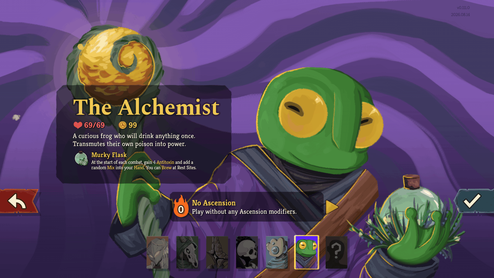
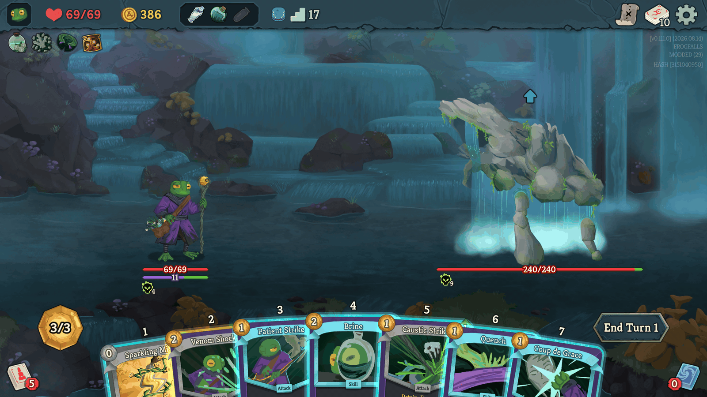
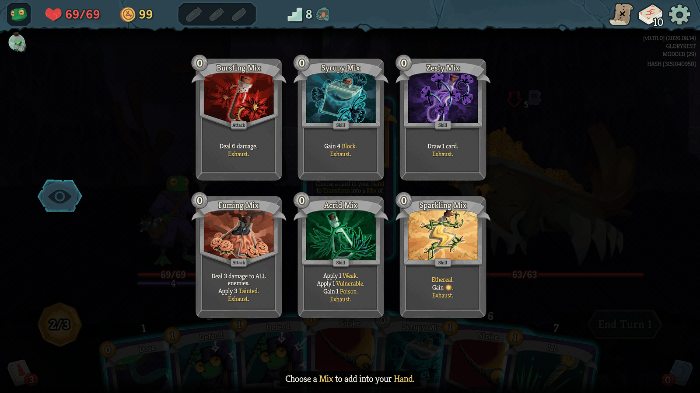
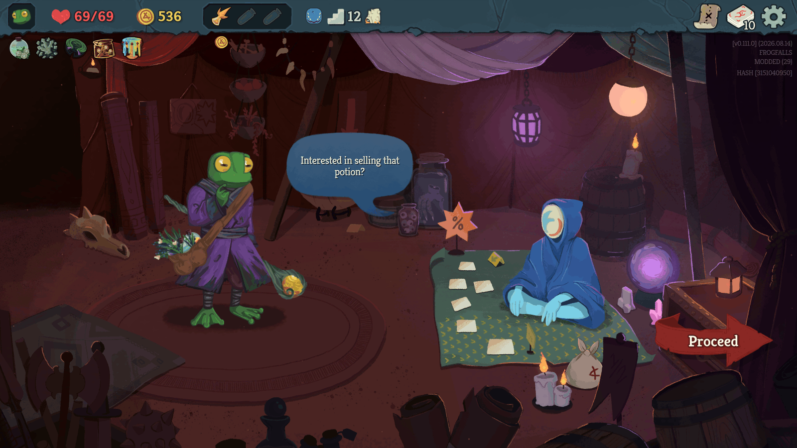

The Alchemist is a new character for Slay the Spire 2: a curious frog who will
drink anything once. They poison themselves on purpose and turn it into power,
mix up potion-like cards in the middle of a fight, let cards ferment in their
hand until they're ready, and brew special potions at Rest Sites to sell to the
Merchant.

## Overview

- ✨ 100+ new cards
- 💎 9 new relics
- 🧪 11 new potions
- 📚 7 timeline epochs
- 🎨 Handmade art and animation
- 🌍 Translated into 15 languages
- 🐸 You get to be a frog

## Playstyle

- **Self-Poison**: The Alchemist doses themselves on purpose. Some attacks deal
  more damage the more Poison you have, and other cards trigger every time your
  Poison does. Poison works on enemies too, and some cards hit harder against a
  Poisoned enemy.
- **Antitoxin**: Protects you from your own Poison. Each time your Poison
  triggers, Antitoxin prevents up to that much damage. It isn't used up, but it
  goes down by 1 at the start of each turn.
- **Mix**: 0-cost cards you create in combat, a lot like potions you play from
  your hand. The basic Mixes are Bursting (damage), Syrupy (Block) and Zesty
  (draw). The volatile Mixes are Fuming (damage to all enemies and Tainted),
  Acrid (Weak and Vulnerable) and Sparkling (Energy).
- **Ferment**: These cards Retain and get stronger for every turn they stay in
  your hand.
- **Brew**: A new Rest Site option that upgrades a random card in your deck and
  lets you choose 1 of 3 special potions. There are 8 of these potions, and
  brewing is the only way to get them. Due to the quality of these brews, the
  Merchant is willing to buy them from you for 100 Gold.

<!-- The website shows this section up to here -->

  
  
  
  

## Disclaimer

This mod is still a work in progress and content is subject to change, but
feedback is welcome! The best place to talk about the mod is the
[Alchemist post](https://discord.com/channels/309399445785673728/1536374761699938424)
in #modding-forum on the official Slay the Spire Discord server.

Language translations are auto-generated for now. The plan is to commission
native translators once the content changes slow down. In the meantime,
corrections are appreciated! If you see an error in your language, please
contact me or feel free to open a pull request on GitHub.

<!-- The website shows this section up to here -->

If you turn on anonymous run sharing, your runs help balance the character. You
can see the results from every player, along with every card, relic, potion and
patch note, at [alchemist.fyi](https://alchemist.fyi/).

## Credits

Design and Code - Seth\
Art and Animation - [Fulgur](https://fulgur.carrd.co/)

Includes additional content for these awesome mods!

- [The Hero Expansion](https://steamcommunity.com/sharedfiles/filedetails/?id=3749294247)
- [Reshuffled Spire](https://steamcommunity.com/sharedfiles/filedetails/?id=3771076270)
- [Ancients Awakened](https://steamcommunity.com/sharedfiles/filedetails/?id=3747492675)

---

## Play it

> [!NOTE]
> The Steam Workshop is the best way to install the mod, because Steam also
> prompts you to install BaseLib. There is one Workshop item for each game
> branch:
>
> - Public game: https://steamcommunity.com/sharedfiles/filedetails/?id=3781688551
> - Beta game (`public-beta`): https://steamcommunity.com/sharedfiles/filedetails/?id=3780726901
>
> The mod is also on Nexus Mods:
> https://www.nexusmods.com/slaythespire2/mods/1439

**Manual install:**

1. Install
   **[BaseLib](https://steamcommunity.com/workshop/filedetails/?id=3737335127)**.
   Most mods use this framework, so you may already have it.
2. Download the zip for your game branch from the
   [Releases](https://github.com/sethmcleod/sts2-the-alchemist/releases) page.
   Use `Alchemist-vX.Y.Z.zip` for the public game and
   `Alchemist-vX.Y.Z-beta.zip` for the beta.
3. Extract the `Alchemist/` folder into the `mods/` folder of your game:
   - **macOS**: `Slay the Spire 2/SlayTheSpire2.app/Contents/MacOS/mods/`
   - **Windows/Linux**: the `mods/` folder next to the game executable.
